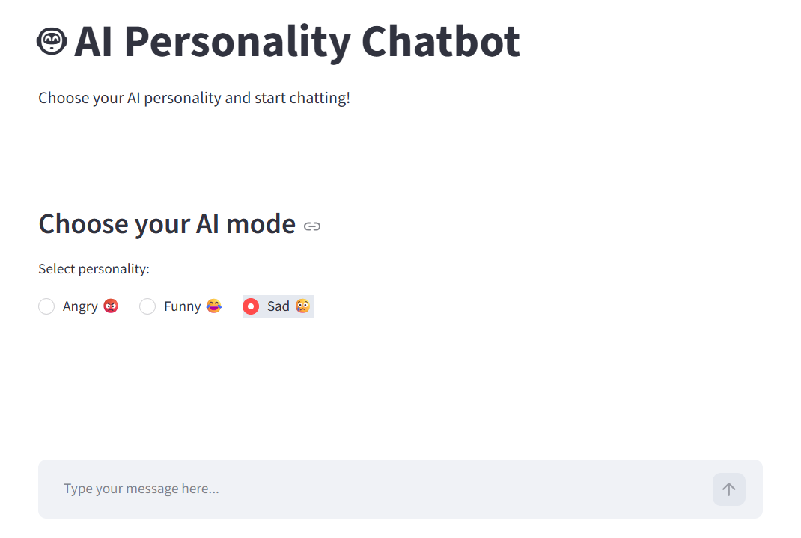

# 🤖 AI Personality Chatbot

An interactive AI-powered chatbot that lets users experience conversations through different AI personalities. Choose between **Angry, Funny, and Sad** modes and interact with an AI that responds according to the selected personality.
## 📸 Application Preview


Built using Python, LangChain, Google Gemini API, and Streamlit.

## ✨ Features

- **Three AI Personalities:** Choose between Angry 😡, Funny 😂, and Sad 🥺 modes.
- **Personality-Based Responses:** Each mode provides responses with a different conversational tone.
- **Interactive Chat Interface:** Clean and simple user interface built with Streamlit.
- **Google Gemini Integration:** Uses Google's Gemini model to generate conversational responses.
- **LangChain Integration:** Uses LangChain for model interaction and prompt handling.

## 🛠️ Tech Stack

| Technology | Purpose |
|---|---|
| Python | Core programming language |
| LangChain | LLM integration and prompt handling |
| Google Gemini API | AI-powered response generation |
| Streamlit | Interactive chatbot interface |

## 📁 Project Structure

```text
Generative AI/
│
├── chatmodels/
│   ├── chat.py
│   ├── localmodel.py
│   └── streamlit_app.py
│
├── embeddingmodels/
│   └── huggingface_embedding.py
│
├── .env
├── .gitignore
└── requirements.txt
```

## 🚀 Getting Started

### 1. Clone the repository

```bash
git clone https://github.com/AanchalJha05/ChatBot.git
```

### 2. Navigate to the project directory

```bash
cd ChatBot
```

### 3. Create a virtual environment

```bash
python -m venv .venv
```

### 4. Activate the virtual environment

**Windows:**

```bash
.venv\Scripts\activate
```

### 5. Install dependencies

```bash
pip install -r requirements.txt
```

### 6. Configure API Key

Create a `.env` file in the root directory and add your Google Gemini API key:

```env
GOOGLE_API_KEY=your_api_key_here
```

Get your API key from [Google AI Studio](https://aistudio.google.com/apikey).

### 7. Run the chatbot

```bash
streamlit run chatmodels/streamlit_app.py
```

The application will open in your browser.

## 💬 Available AI Personalities

| Personality | Behaviour |
|---|---|
| 😡 Angry | Responds with an angry and annoyed tone |
| 😂 Funny | Responds with humour and a playful tone |
| 🥺 Sad | Responds with a sad and emotional tone |

## 🔒 Environment Variables

Never upload your `.env` file or expose your API keys publicly. Keep sensitive credentials private using `.gitignore`.

## 👩‍💻 Author

**Aanchal Jha**

- GitHub: [@AanchalJha05](https://github.com/AanchalJha05)

---

⭐ If you find this project interesting, consider giving the repository a star!